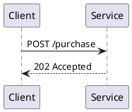

# Sequence

A native macOS app for reading and writing PlantUML diagrams and markdown from a folder on your disk.

Keep your flows next to your RFCs, browse them in a sidebar, and edit with a live preview. Everything stays local: no account, no cloud, no import step.

## Features

- **Folder as a library.** Open any folder. Each window has its own folder, so open a second window (⌘N) to work in two places at once. The first window restores the last folder; new windows start empty. Files appear in a sidebar, with top-level folders as sections. The tree updates when files change on disk.
- **View, edit, or both.** Switch between View (rendered), Edit (code only) and Edit with preview (code and live render side by side) with the icons in the page header. Diagrams and markdown share the same three modes.
- **Markdown with diagrams.** ` ```plantuml `, ` ```puml ` and ` ```uml ` fenced blocks render as diagrams inside the markdown preview. Frontmatter is hidden, and raw HTML is escaped.
- **Live rendering.** PlantUML runs in one long-lived Java process, so previews update as you type.
- **Playground.** Two scratch editors, **PlantUML Playground** and **Markdown Playground**, opened from the left strip, the File menu, or the empty state when no file is open, always in Edit with preview and with the sidebar hidden (the Files icon in the left strip returns), for trying a diagram or a markdown snippet without creating a file. Each has its own text, remembered between launches, and **Save to folder…** writes it out as a real file. It works even before you open a folder.
- **Markdown formatting.** Select text in a markdown file and press ⌘B for bold or ⌘I for italic; press again to remove it. Combining both gives bold italic.
- **AI prompt.** Type a change in plain language at the bottom of the editor ("add a retry loop after the payment call") and Claude rewrites the open diagram or document. It needs the [Claude Code](https://claude.com/claude-code) CLI installed and signed in; the text of the open file is sent to Claude. **Undo** restores the text from before the change.
- **Search and file operations.** Filter files by name, and create, rename or delete (to Trash) from the sidebar.
- **Export and copy.** Save a diagram as SVG or PNG, or right-click any diagram, in the viewer or inside a markdown preview, and choose **Copy Image**.
- **Light and Dark themes.** A toggle in the left strip overrides the system appearance. Dark follows the VS Code "Dark Modern" palette.
- **Safe editing.** The app asks before discarding unsaved changes, and tells you when a file changes on disk while you have edits.

Supported files: `.puml`, `.plantuml`, `.pu`, `.wsd` (diagrams) and `.md` (markdown).

## Requirements

- macOS 14 or later
- A JDK, only to build (for example `brew install openjdk`). The built app bundles its own Java runtime, so the machine you run it on needs no Java.
- Swift command line tools, to build. Xcode is not needed.
- Graphviz (optional). Without it PlantUML falls back to its built-in layout engine, which handles class, component, use case, state and activity diagrams.

The app uses its bundled Java runtime. When run without one (for example from source), it falls back to Java in the common Homebrew and system locations.

## Build and run

```sh
git clone <repo-url> sequence
cd sequence
./build-app.sh
open build/Sequence.app
```

`build-app.sh` compiles the Swift package and assembles an ad-hoc signed `Sequence.app` in `build/`, with the PlantUML jar and a trimmed Java runtime bundled inside. Quit a running copy (⌘Q) before rebuilding, or reopening shows the old build.

On first launch, choose a folder. The app remembers it and the last file you opened.

## Usage

| Action | Shortcut |
|---|---|
| New window | ⌘N |
| Add folder as vault | ⌘O |
| PlantUML playground | ⌘⇧P |
| Markdown playground | ⌘⇧M |
| Save | ⌘S |
| Show or hide sidebar | ⌘⌃S |
| Find in file | ⌘F |
| Bold, italic (markdown) | ⌘B, ⌘I |
| About Sequence | ⌘, |

Export SVG and PNG are in the File menu.

A markdown file can embed a diagram like this:

````markdown
# Purchase flow


````

A block without `@startuml` / `@enduml` is wrapped automatically. Relative `!include` paths resolve against the file's folder.

## How it works

- **Rendering.** The bundled `plantuml.jar` runs as `java -jar plantuml.jar -pipe -tsvg`, and requests are serialized through a single actor. A watchdog restarts the process if it stalls.
- **Safety.** Remote includes and URLs in diagram source are blocked, and the markdown preview escapes raw HTML, so opening a document cannot fetch or run remote content.
- **UI.** SwiftUI and AppKit. Diagrams and markdown are shown in web views. The editor is a native text view with line numbers.

## Development

```sh
./test.sh
```

The tests use Swift Testing against the Command Line Tools frameworks, so plain `swift test` does not work without Xcode.

```
Sources/StudioCore   UI-free engine: renderer, scanner, watcher, file operations, documents
App                  SwiftUI and AppKit views, and the app model
App/Resources        Bundled PlantUML jar, markdown parser, icon
Tests/StudioCoreTests
docs/superpowers     Original design spec and implementation plan
```

Logic lives in `StudioCore` and is covered by tests. Views in `App` are not unit tested.

## Limitations

- The bundled Java runtime matches the architecture of the machine that built the app, so a build made under Rosetta (x86_64) runs on Apple Silicon only through Rosetta.
- The app is ad-hoc signed, not notarized, so Gatekeeper blocks the first launch on another Mac (right-click the app and choose Open).
- `.mdx` is not supported, and there is no Confluence import.

## Third-party software

- [PlantUML](https://plantuml.com) renders the diagrams. The bundled jar is version 1.2026.9, under its own license.
- [marked](https://github.com/markedjs/marked) renders markdown (MIT).

## License

No license has been chosen yet.
